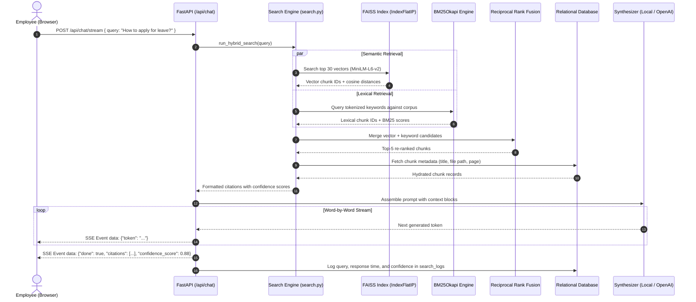
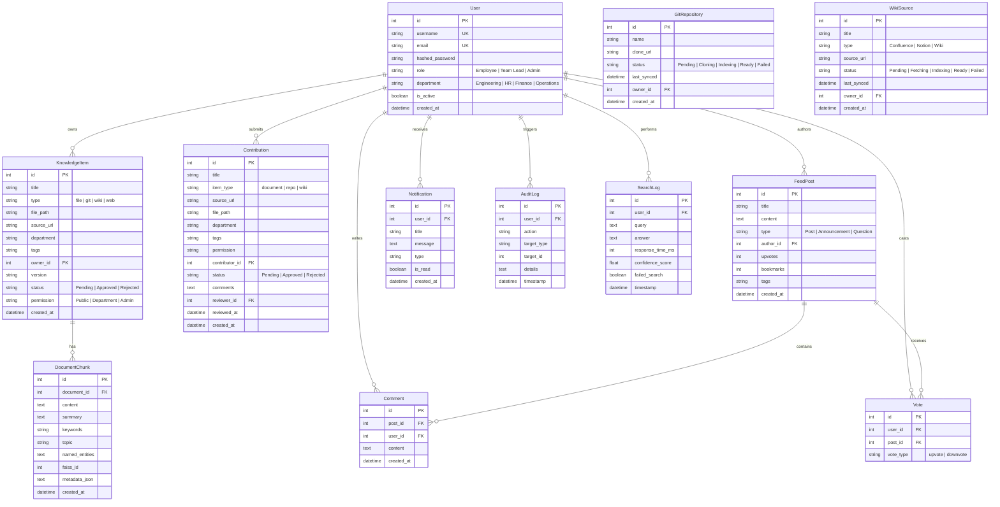

# 🔮 NexusQuery AI — Enterprise Knowledge Discovery Platform

> **Comprehensive Platform Documentation & Architectural Blueprint**  
> *A production-grade, AI-powered knowledge operating system unifying enterprise documents, codebases, wikis, and team discussions into a single conversational intelligence engine.*

---

## 📑 Table of Contents

1. [Executive Summary & Vision](#1-executive-summary--vision)
2. [Platform Architecture & System Design](#2-platform-architecture--system-design)
3. [Comprehensive Feature Catalog](#3-comprehensive-feature-catalog)
4. [Deep Dive: AI, Vector & RAG Pipeline](#4-deep-dive-ai-vector--rag-pipeline)
   - [Document Ingestion & File Parsers](#document-ingestion--file-parsers)
   - [DataBloom Metadata Extraction Engine](#databloom-metadata-extraction-engine)
   - [Embedding Model & Offline Fallback](#embedding-model--offline-fallback)
   - [FAISS Vector Database Management](#faiss-vector-database-management)
   - [BM25 Lexical Retrieval & Reciprocal Rank Fusion (RRF)](#bm25-lexical-retrieval--reciprocal-rank-fusion-rrf)
   - [Answer Synthesis & Server-Sent Events (SSE) Streaming](#answer-synthesis--server-sent-events-sse-streaming)
5. [Data Sources & Integration Subsystems](#5-data-sources--integration-subsystems)
   - [Multi-Format Document Upload](#multi-format-document-upload)
   - [GitQuery Codebase Intelligence](#gitquery-codebase-intelligence)
   - [WikiQuery Confluence & Notion Scraper](#wikiquery-confluence--notion-scraper)
   - [Web URL Crawler](#web-url-crawler)
6. [Database Schema & Data Models](#6-database-schema--data-models)
7. [API Directory & Endpoint Reference](#7-api-directory--endpoint-reference)
8. [Frontend Application Architecture & UI Guide](#8-frontend-application-architecture--ui-guide)
9. [Role-Based Access Control (RBAC) & Security](#9-role-based-access-control-rbac--security)
10. [Collaborative Knowledge & Community Feed](#10-collaborative-knowledge--community-feed)
11. [Enterprise Analytics & Knowledge Gap Discovery](#11-enterprise-analytics--knowledge-gap-discovery)
12. [DevOps, Docker & Deployment](#12-devops-docker--deployment)
13. [Configuration & Environment Variables](#13-configuration--environment-variables)
14. [Installation & Getting Started Guide](#14-installation--getting-started-guide)
15. [Default Credentials & Verification](#15-default-credentials--verification)

---

## 1. Executive Summary & Vision

### What is NexusQuery AI?
**NexusQuery AI** is an enterprise-grade **Knowledge Operating System (KOS)** designed to eliminate institutional silos, fragmented documentation, and lost developer hours. Modern companies distribute their organizational knowledge across PDFs, Word documents, slide decks, Confluence wikis, Notion spaces, and GitHub code repositories. Employees often spend up to 20% of their work week searching for internal information or waiting on teammates to answer repetitive questions.

Inspired by state-of-the-art enterprise tools like **Glean**, **Microsoft 365 Copilot**, **Atlassian Intelligence**, and **Notion AI**, NexusQuery AI provides a unified, conversational search layer. Instead of manually sifting through folders, files, and pull requests, team members can ask natural language questions and receive accurate, synthesized answers with **exact inline citations**, **relevance confidence scores**, and **suggested follow-ups**.

### Core Value Propositions
* **Single Pane of Glass**: Index corporate files, source code repositories, and intranet wikis in a single searchable repository.
* **Hybrid Search Engine**: Combines semantic vector similarity search (**FAISS**) with exact lexical keyword matching (**BM25 Okapi**) using **Reciprocal Rank Fusion (RRF)**.
* **Deterministic Citations**: Every generated statement is backed by verifiable document citations `[1]`, `[2]` with file path and page/line metadata.
* **Zero Cloud Dependency Fallback**: Operates fully on-premise without requiring paid cloud APIs. Uses local HuggingFace embeddings (`all-MiniLM-L6-v2`) and local rule-based synthesis when OpenAI API keys are absent.
* **Enterprise Security & Governance**: Multi-tier Role-Based Access Control (RBAC), department-level permission isolation, end-to-end audit logging, and document review queues.
* **Social Knowledge Sharing**: An internal social knowledge feed allowing team members to post guides, share updates, upvote verified solutions, and comment on findings.

---

## 2. Platform Architecture & System Design

NexusQuery AI is designed as a decoupled, multi-container system with a high-performance **FastAPI** backend and an interactive **React 19 + TypeScript + Vite** frontend.

```mermaid
graph TB
    subgraph Client ["Client Layer (Browser / React 19 SPA)"]
        UI[Tailwind CSS Dark Mode UI]
        ChatUI[AI Assistant & Streaming Chat]
        HubUI[Knowledge Hub & File Manager]
        GitUI[Git Tree & Code Inspector]
        WikiUI[Wiki Space Manager]
        AdminUI[Admin Console & Audit Logs]
        AnalyticsUI[Recharts Analytics Dash]
    end

    subgraph API ["Application Server (FastAPI on Port 8000)"]
        RouterAuth["Auth Router (/api/auth)"]
        RouterChat["Chat & SSE Router (/api/chat)"]
        RouterKnowledge["Knowledge Router (/api/knowledge)"]
        RouterGit["Git Router (/api/git)"]
        RouterWiki["Wiki Router (/api/wiki)"]
        RouterContribute["Contribute Router (/api/contribute)"]
        RouterFeed["Feed Router (/api/feed)"]
        RouterAnalytics["Analytics Router (/api/analytics)"]
        RouterAdmin["Admin Router (/api/admin)"]
        
        Middleware[CORS & JWT Bearer Security]
    end

    subgraph Engine ["AI & Processing Engine"]
        Extractor[File Extractors: PDF, DOCX, PPTX, HTML]
        DataBloom[DataBloom Metadata & Topic Classifier]
        Chunker[Recursive Semantic Chunker: 500 tokens / 100 overlap]
        Embedder[SentenceTransformer / all-MiniLM-L6-v2 (dim=384)]
        FAISS_Engine[FAISS Flat L2 / Cosine Index]
        BM25_Engine[BM25Okapi Lexical Ranker]
        RRF[Reciprocal Rank Fusion (RRF) Re-ranker]
        Synthesizer[LLM / Local Context Synthesizer]
    end

    subgraph Storage ["Persistent Storage Layer"]
        MySQL[(MySQL 8.0 Primary DB / SQLite Fallback)]
        FAISS_Disk[(FAISS Vector Files: /data/faiss_index)]
        Uploads[(Document Storage: /data/uploads)]
        GitClones[(Git Clones: /data/git_clones)]
    end

    UI -->|REST API / JWT| API
    ChatUI -->|SSE Stream /api/chat/stream| RouterChat
    API --> Engine
    Engine --> Storage
    API --> Storage
```

### Architectural Principles
1. **Stateless Backend APIs**: All authentication is token-based using JSON Web Tokens (JWT HS256) with access token rotation, allowing horizontal backend scaling.
2. **Dual Database Architecture (MySQL + SQLite Fallback)**: By default, the application connects to MySQL 8.0 in production/Docker. If MySQL is unreachable, it automatically and gracefully initializes an embedded SQLite database at `backend/data/nexusquery.db` with zero downtime or crash.
3. **Dual Search Paradigm (Hybrid RAG)**: Rather than relying solely on dense vector search (which can miss exact keywords, function names, and acronyms), NexusQuery AI performs simultaneous dense and sparse retrievals, reconciling candidates via Reciprocal Rank Fusion.
4. **Asynchronous Non-Blocking Tasks**: Time-intensive operations (such as cloning git repositories, crawling web spaces, and rebuilding FAISS vector indexes) run in background threads (`BackgroundTasks`) to maintain immediate HTTP response latencies.

---

## 3. Comprehensive Feature Catalog

NexusQuery AI includes an extensive set of production modules:

| Module | Core Capabilities |
| :--- | :--- |
| **🤖 AI Assistant (RAG Chat)** | • Natural language question-answering over all indexed organizational knowledge<br>• Real-time word-by-word streaming responses via Server-Sent Events (SSE)<br>• Verified inline citation markers `[1]`, `[2]` linked to documents, pages, and lines<br>• Numerical confidence score calculated from vector and lexical match density<br>• Dynamic suggested follow-up questions tailored to query context |
| **🔍 Hybrid Search Engine** | • Simultaneous FAISS dense inner-product vector retrieval (semantic context)<br>• In-memory BM25Okapi sparse retrieval (exact terminology & acronyms)<br>• Reciprocal Rank Fusion (RRF) algorithm to re-rank results without score drift<br>• Support for query filtering by department, document format, and permission tag |
| **📄 Knowledge Hub** | • Drag-and-drop ingestion of `.pdf`, `.docx`, `.pptx`, `.txt`, `.md`, and `.html` files<br>• Web URL extraction and indexation<br>• Automatic text cleaning and non-printable control character removal<br>• Interactive Document Chunk Inspector displaying generated summaries, keywords, topics, and named entities<br>• Document deletion and associated vector de-allocation |
| **🐙 GitQuery Engine** | • Remote GitHub/GitLab repository cloning (`git clone --depth 1`)<br>• Smart file tree traversal ignoring binary files, lockfiles, and virtual environments<br>• Code-aware chunking preserving function blocks with line number tracking<br>• Interactive directory tree explorer and in-browser code viewer with line numbers<br>• Natural language code queries (e.g., *"Where is payment authentication handled?"*) |
| **📚 WikiQuery Engine** | • Scraper for Confluence, Notion, and general intranet wiki pages<br>• HTML boilerplate stripping (navbars, scripts, CSS) and clean text extraction<br>• Built-in mock company spaces for immediate local testing: Engineering SOP, HR Onboarding Checklist, and Employee Leave Policy<br>• Background re-syncing and change tracking |
| **📥 Contribution Review Pipeline** | • Employee submission portal for suggesting documents, repos, or wiki articles<br>• Three-stage status workflow: `Pending` ➔ `Approved` / `Rejected`<br>• Dedicated review console for Team Leads and Administrators with review comment logging<br>• Automated background ingestion and vector indexing immediately upon approval |
| **🗞️ Collaborative Feed** | • Company-wide social knowledge feed with posts, announcements, and Q&A threads<br>• Upvote / downvote voting engine with deduplication to prevent double-voting<br>• Personal post bookmarking system<br>• Threaded comments supporting peer collaboration on organizational decisions |
| **📊 Enterprise Analytics** | • Search performance dashboard: total queries, search success rates, and average response times<br>• Knowledge Gap Identification: flags queries that yielded low confidence (<25%) or zero results<br>• Departmental query breakdown (Engineering, HR, Finance, Operations)<br>• Daily query volume trends visualized through Recharts area and bar graphs |
| **🛡️ Admin Console & Governance** | • Complete user management: view all accounts, modify roles, and activate/deactivate accounts<br>• Centralized audit logging recording every system action with user ID and timestamp<br>• System health monitor tracking database connectivity, vector index health, and chunk volume<br>• Triggerable full FAISS vector index re-index job |
| **🔔 Notification System** | • Real-time notification inbox alerting users of contribution reviews, system events, and updates<br>• Unread notification badge counter on the top navigation bar<br>• Single-click "Mark All as Read" action |

---

## 4. Deep Dive: AI, Vector & RAG Pipeline

NexusQuery AI's Retrieval-Augmented Generation pipeline is built to be fast, dependable, and self-contained.



### Document Ingestion & File Parsers
File ingestion is handled in [backend/app/pipeline.py](file:///s:/downloads/NexusQuery/backend/app/pipeline.py) and [backend/app/routers/knowledge.py](file:///s:/downloads/NexusQuery/backend/app/routers/knowledge.py):
* **PDFs (`pypdf.PdfReader`)**: Reads page-by-page, retaining the exact page number for each chunk so citations point directly to pages (e.g., `Employee_Handbook.pdf, Page 4`).
* **Word Documents (`docx.Document`)**: Extracts structured paragraphs while stripping XML formatting.
* **Presentations (`pptx.Presentation`)**: Traverses slides and individual shapes to capture bullet points, tables, and slide headers.
* **HTML / Web (`bs4.BeautifulSoup`)**: Removes `<script>`, `<style>`, and navigation containers, retaining semantic article text.
* **Markdown / Plain Text (`.txt`, `.md`)**: Raw UTF-8 reading with control-character stripping.

### DataBloom Metadata Extraction Engine
Each extracted text chunk is processed through the **DataBloom** engine in `backend/app/pipeline.py` prior to database insertion:
1. **Keyword Extraction**: Cleans stopwords and computes word frequency distributions to assign the top 6 most representative keywords.
2. **Dynamic Topic Classification**: Scores chunks against organizational department dictionaries (Engineering, HR, Finance, Operations) and tags the highest scoring topic.
3. **Named Entity Recognition (Pattern-Based)**: Extracts capitalized multi-word phrases and organizational entities.
4. **Instant Chunk Summary**: Generates concise single-sentence abstracts (120–150 characters) displayed in the chunk inspector.

### Embedding Model & Offline Fallback
Embeddings are created using `sentence-transformers/all-MiniLM-L6-v2`:
* **Dimension**: 384 floating-point numbers.
* **Normalization**: Vectors are normalized to unit length ($L_2$ norm = 1.0), allowing inner product calculation to represent exact Cosine Similarity.
* **Deterministic Fallback Engine**: If the PyTorch/HuggingFace model cannot load or the host lacks internet access during first launch, the `NexusEmbeddingModel` activates an internal deterministic hashing algorithm. This produces consistent 384-dimensional unit vectors from word hashes, ensuring zero crash rate in offline test environments.

### FAISS Vector Database Management
Managed by `FAISSIndexManager` in `backend/app/pipeline.py`:
* **Index Structure**: Uses `faiss.IndexFlatIP` (Flat Inner Product) for exact, uncompressed cosine distance computation.
* **Disk Persistence**: Vector indices are written directly to `backend/data/faiss_index/index.faiss`.
* **Dynamic Sizing**: Automatically creates new indices if no saved index exists, and appends new vectors atomically when documents or code are uploaded.

### BM25 Lexical Retrieval & Reciprocal Rank Fusion (RRF)
Implemented in [backend/app/search.py](file:///s:/downloads/NexusQuery/backend/app/search.py):
1. **Dense Vector Search**: Returns top 30 semantically similar candidates from FAISS.
2. **Sparse Lexical Search**: Tokenizes the query into terms and evaluates candidates with `BM25Okapi`.
3. **Reciprocal Rank Fusion**: Re-ranks candidates across both methodologies using the standard formula:
   $$\text{Score}(d) = \sum_{m \in \{\text{vector}, \text{bm25}\}} \frac{1}{k_{\text{rrf}} + \text{Rank}_m(d) + 1}$$
   *(where $k_{\text{rrf}} = 60$)*. This prevents score scale mismatches and ensures documents matching exact technical identifiers (e.g., `JWT_SECRET_KEY`) appear at the top.

### Answer Synthesis & Server-Sent Events (SSE) Streaming
The platform supports two generation strategies:
1. **Cloud LLM (OpenAI GPT)**: When `OPENAI_API_KEY` is provided, prompt context blocks containing numbered citations are sent to `gpt-4o-mini` with strict citation constraints.
2. **Local Context Synthesizer (Zero-Cost Local Mode)**: When no API key is supplied, a built-in local synthesizer extracts the highest-scoring sentences directly matching the query, structures them into coherent paragraphs, tags them with exact source identifiers, and computes overall confidence.
3. **SSE Streaming**: Both `/api/chat/stream` and the React frontend communicate via Server-Sent Events (`text/event-stream`), delivering interactive token-by-token output with near-zero initial latency.

---

## 5. Data Sources & Integration Subsystems

### Multi-Format Document Upload
Uploaded files are stored under `backend/data/uploads/`. The file router records metadata in `knowledge_items`, creates individual chunks in `document_chunks`, embeds them into FAISS, and logs the upload in `audit_logs`. Users can inspect individual document chunks directly in the Knowledge Hub UI.

### GitQuery Codebase Intelligence
Located in [backend/app/gitquery.py](file:///s:/downloads/NexusQuery/backend/app/gitquery.py) and [backend/app/routers/git.py](file:///s:/downloads/NexusQuery/backend/app/routers/git.py):
* **Repository Cloning**: Executes `git clone --depth 1` into `backend/data/git_clones/{repo_id}`.
* **Mock Code Generator**: For sandboxed demonstration or URLs containing `"example"` / `"mock"`, the system automatically provisions a realistic microservice repository containing `auth.py`, `models.py`, `payments.py`, and `redis_helper.py`.
* **Intelligent File Filtering**: Automatically skips binary files (`.png`, `.exe`, `.so`, `.pdf`, `.zip`), node modules, virtual environments, and build directories.
* **Code Chunking**: Chunks code files into ~40-line blocks with 5-line overlaps, preserving function and class context alongside line number metadata (`start_line`, `end_line`).
* **Codebase Tree Explorer**: A recursive JSON directory tree endpoint (`/api/git/{id}/tree`) powers an interactive visual directory tree on the frontend.
* **Security & Path Traversal Guards**: The file viewer endpoint validates canonical system paths to prevent directory traversal attacks (`../`).

### WikiQuery Confluence & Notion Scraper
Located in [backend/app/wikiquery.py](file:///s:/downloads/NexusQuery/backend/app/wikiquery.py) and [backend/app/routers/wiki.py](file:///s:/downloads/NexusQuery/backend/app/routers/wiki.py):
* Scrapes intranet wiki pages, strips HTML boilerplate, and extracts clean markdown/plain text.
* Pre-configured with three full internal corporate wiki articles for demonstration:
  1. *Engineering Standard Operating Procedures (SOP)*
  2. *Onboarding Guide & Checklist for New Hires*
  3. *Leave and Vacation Policy*

### Web URL Crawler
Enables single-page web crawling via `/api/knowledge/index-url`. Automatically fetches target HTML, strips scripts and styles, chunks content, and integrates it into the primary search index.

---

## 6. Database Schema & Data Models

NexusQuery AI features **10 primary SQLAlchemy ORM entities** defined in [backend/app/models.py](file:///s:/downloads/NexusQuery/backend/app/models.py):



---

## 7. API Directory & Endpoint Reference

All endpoints are hosted at `http://localhost:8000` with automated interactive OpenAPI documentation at `/docs` and ReDoc at `/redoc`.

### Authentication (`/api/auth`)
* `POST /api/auth/register` — Create a new account with specified department and role.
* `POST /api/auth/login` — Authenticate using username or email; returns access token (HS256) and refresh token.
* `POST /api/auth/refresh` — Issue a new access token using a valid refresh token.
* `POST /api/auth/reset-password` — Update user password by email verification.
* `GET /api/auth/me` — Retrieve current authenticated user profile (`Bearer` token required).

### Knowledge Management (`/api/knowledge`)
* `POST /api/knowledge/upload` — Multi-part file upload (`.pdf`, `.docx`, `.pptx`, `.txt`, `.md`, `.html`) with department and permission tagging.
* `POST /api/knowledge/index-url` — Crawl and index an external web URL.
* `GET /api/knowledge/list` — List all accessible documents filtered by user role and department permissions.
* `GET /api/knowledge/{doc_id}/chunks` — Retrieve all extracted chunks and DataBloom metadata for a specific document.

### AI Search & Chat (`/api/chat`)
* `POST /api/chat/query` — Single-shot RAG search returning answer text, citations, confidence score, and suggested follow-ups.
* `POST /api/chat/stream` — Real-time Server-Sent Events (SSE) streaming answer generator with token-by-token output.

### Git Intelligence (`/api/git`)
* `POST /api/git/connect` — Add a new remote repository and trigger background cloning and indexing.
* `GET /api/git/list` — View all connected repositories and their indexing statuses.
* `POST /api/git/{repo_id}/sync` — Trigger an on-demand re-sync of a repository.
* `GET /api/git/{repo_id}/tree` — Retrieve the full directory structure as a nested JSON tree.
* `GET /api/git/{repo_id}/file?path=...` — Read raw file contents with directory traversal protection.

### Wiki Intelligence (`/api/wiki`)
* `POST /api/wiki/connect` — Connect a Confluence or Notion URL and trigger background scraping.
* `GET /api/wiki/list` — List all tracked wiki spaces.
* `POST /api/wiki/{wiki_id}/sync` — Trigger a fresh crawl of a wiki space.

### Contributions & Review (`/api/contribute`)
* `POST /api/contribute/submit` — Submit a document, repo, or wiki for peer review.
* `GET /api/contribute/list` — Fetch submissions (all for Admins/Leads; personal submissions for Employees).
* `POST /api/contribute/{contrib_id}/review` — Approve or reject a submission with review comments (Team Lead / Admin only).

### Collaborative Feed (`/api/feed`)
* `GET /api/feed/posts` — Retrieve community knowledge posts with comment counts and user vote states.
* `POST /api/feed/post` — Create a new post, announcement, or question.
* `POST /api/feed/posts/{post_id}/vote` — Cast or toggle an upvote/downvote with automatic deduplication.
* `POST /api/feed/posts/{post_id}/comment` — Add a comment to an existing post.

### Enterprise Analytics (`/api/analytics`)
* `GET /api/analytics/summary` — Retrieve total searches, success rates, average response latency, department breakdown, and vector index volume.
* `GET /api/analytics/searches-over-time` — Retrieve daily query volume history over the past 7 days.

### Administration & Operations (`/api/admin`)
* `GET /api/admin/users` — List all registered users (Admin only).
* `PUT /api/admin/users/{user_id}/role` — Promote or demote user roles (`Employee`, `Team Lead`, `Admin`).
* `PUT /api/admin/users/{user_id}/status` — Enable or deactivate user accounts.
* `GET /api/admin/audit-logs` — Retrieve system-wide audit logs with actor and timestamp details.
* `POST /api/admin/reindex` — Trigger a background rebuild of the entire FAISS vector database from stored database chunks.

### Notifications (`/api/notifications`)
* `GET /api/notifications/list` — Retrieve the latest 20 notifications for the current user.
* `POST /api/notifications/{notif_id}/read` — Mark an individual notification as read.
* `POST /api/notifications/read-all` — Mark all notifications as read.

### Dashboard (`/api/dashboard`)
* `GET /api/dashboard/metrics` — Aggregate platform counts (documents, repos, wikis, users, daily queries), recent activities, and trending topics.

---

## 8. Frontend Application Architecture & UI Guide

The frontend application is built in **React 19** using **TypeScript**, styled with modern enterprise dark mode tokens via **Tailwind CSS**, and bundled with **Vite 5**.

```
frontend/src/
├── main.tsx              # Application entry point and React DOM render
├── App.tsx               # Route configurations, layout wrapper, and ProtectedRoute guard
├── index.css             # Dark theme variables, custom scrollbars, and keyframe animations
├── context/
│   └── AuthContext.tsx   # Global authentication state, Axios JWT interceptors, and user session
├── components/
│   ├── Header.tsx        # Top navigation bar, search shortcut, notifications drawer, and user badge
│   └── Sidebar.tsx       # Collapsible sidebar with role-aware route navigation links
└── pages/
    ├── Login.tsx         # User authentication page with gradient cards
    ├── Register.tsx      # User registration with department and role selection
    ├── Dashboard.tsx     # Executive command center with quick search, metrics, and activity feeds
    ├── KnowledgeHub.tsx  # Document repository, drag-and-drop uploader, and chunk inspector modal
    ├── GitQuery.tsx      # Codebase search, file tree navigator, and in-browser code viewer
    ├── WikiQuery.tsx     # Confluence/Notion space manager and article reader
    ├── AIAssistant.tsx   # Full-page streaming AI chat with interactive citation drawer
    ├── Contribute.tsx    # Peer review submission form and review management table
    ├── Feed.tsx          # Community knowledge board with voting, tags, and comment threads
    ├── Analytics.tsx     # Interactive Recharts graphs and knowledge gap monitors
    ├── AdminConsole.tsx  # User management table, audit trail viewer, and FAISS re-indexer
    └── Settings.tsx      # Profile configuration and security management
```

### Key UI Features
* **Global Search Hotkey**: Interactive quick search accessible from any page.
* **Persistent Dark UI**: High-contrast, accessibility-tested color palette utilizing deep slate, indigo, and violet accents.
* **Citation Inspection Drawer**: In AI Assistant and Knowledge Hub, clicking a citation opens a modal displaying the exact source snippet, file location, and confidence level.
* **Animated State Transitions**: Built with `framer-motion` for smooth modal dialogs, drawer transitions, and live streaming token effects.

---

## 9. Role-Based Access Control (RBAC) & Security

NexusQuery AI implements a strict three-tier role hierarchy enforced at both API dependency levels and React client-side route guards.

```
       ┌────────────────────────────────────────────────────────┐
       │                         Admin                          │
       │   Full platform governance, User management, RBAC,    │
       │   Audit log inspection, Vector re-indexing, Approvals  │
       └───────────────────────────▲────────────────────────────┘
                                   │ inherits
       ┌───────────────────────────┴────────────────────────────┐
       │                       Team Lead                        │
       │   Contribution review, Department analytics,          │
       │   Department-restricted document access               │
       └───────────────────────────▲────────────────────────────┘
                                   │ inherits
       ┌───────────────────────────┴────────────────────────────┐
       │                        Employee                        │
       │   AI query, Document upload, Git & Wiki explore,       │
       │   Feed posts & votes, Contribution submit              │
       └────────────────────────────────────────────────────────┘
```

### Permission Matrix

| Operation | Employee | Team Lead | Admin |
| :--- | :---: | :---: | :---: |
| Search & Query AI Assistant | ✅ | ✅ | ✅ |
| Upload Documents & URLs | ✅ | ✅ | ✅ |
| Connect Git Repositories & Wikis | ✅ | ✅ | ✅ |
| Post, Comment & Vote in Feed | ✅ | ✅ | ✅ |
| Submit Content for Review | ✅ | ✅ | ✅ |
| Review & Approve Contributions | ❌ | ✅ | ✅ |
| View System Audit Logs | ❌ | ❌ | ✅ |
| Modify User Roles & Account Status | ❌ | ❌ | ✅ |
| Trigger System-Wide FAISS Reindex | ❌ | ❌ | ✅ |

### Document-Level Permissions
Every indexed knowledge item is tagged with a permission level:
* **Public**: Accessible by all authenticated users across the company.
* **Department**: Restricted strictly to users belonging to the same organizational department (e.g., Engineering, HR, Finance, Operations).
* **Admin**: Restricted to administrators only.

### Security Controls
* **Password Security**: Passwords are encrypted using `passlib` with `bcrypt` (12 rounds).
* **JWT Access & Refresh Tokens**: Access tokens expire in 60 minutes; refresh tokens provide 7-day rotation.
* **Directory Traversal Protection**: Git file reading endpoints validate absolute paths against the repository root, rejecting `..` traversal attacks.
* **Comprehensive Audit Trail**: Every authentication attempt, upload, indexation, review, and role change is permanently recorded in `audit_logs`.

---

## 10. Collaborative Knowledge & Community Feed

Beyond document search, NexusQuery AI includes an internal collaboration layer modeled after modern technical communities:
* **Categorized Content Types**: Users can publish standard **Posts**, high-priority **Announcements**, or **Questions**.
* **Vote Engine**: Users can upvote helpful documentation or downvote inaccurate advice. The system tracks votes in `feed_votes`, automatically toggling votes or adjusting counts if a user changes their reaction.
* **Threaded Discussions**: Employees can reply directly to posts, providing clarification or linking to relevant documents.
* **Bookmarks**: Individual users can bookmark posts for quick reference.

---

## 11. Enterprise Analytics & Knowledge Gap Discovery

The Analytics module ([backend/app/routers/analytics.py](file:///s:/downloads/NexusQuery/backend/app/routers/analytics.py)) helps knowledge managers understand how employees use the platform and where information is missing.

### Knowledge Gap Identification
NexusQuery AI logs every query to `search_logs`. Searches are categorized as **failed or deficient** if:
1. No matching chunks were found in the knowledge base, or
2. The merged search confidence score was below **25%**.

These queries are highlighted in the Analytics view as **Coverage Gaps**, informing leaders which documentation or guides need to be authored next.

### Visualized Metrics
* **Query Volume Over Time**: Daily search counts over the previous 7 days rendered as area graphs.
* **Departmental Utilization**: Visual distribution of searches originated by Engineering, HR, Finance, and Operations teams.
* **Latency Monitoring**: Average query response times in milliseconds.
* **Vector Corpus Scale**: Real-time counter of total indexed document chunks and active FAISS vectors.

---

## 12. DevOps, Docker & Deployment

The platform is fully containerized using **Docker** and **Docker Compose**, allowing single-command startup.

### Multi-Container Topology (`docker-compose.yml`)

```yaml
services:
  db:
    image: mysql:8.0
    container_name: nexus_db
    restart: always
    environment:
      MYSQL_ROOT_PASSWORD: root_password
      MYSQL_DATABASE: nexusquery_db
      MYSQL_USER: nexus_user
      MYSQL_PASSWORD: nexus_password
    ports:
      - "3306:3306"
    volumes:
      - mysql_data:/var/lib/mysql
    healthcheck:
      test: ["CMD", "mysqladmin", "ping", "-h", "localhost", "-u", "nexus_user", "-pnexus_password"]
      interval: 5s
      timeout: 5s
      retries: 5

  backend:
    build:
      context: ./backend
      dockerfile: Dockerfile
    container_name: nexus_backend
    restart: always
    ports:
      - "8000:8000"
    environment:
      - MYSQL_HOST=db
      - MYSQL_PORT=3306
      - MYSQL_USER=nexus_user
      - MYSQL_PASSWORD=nexus_password
      - MYSQL_DB=nexusquery_db
      - JWT_SECRET_KEY=nexus-query-ai-super-secret-key-1234567890-qwertyuiop
      - EMBEDDING_MODEL_NAME=all-MiniLM-L6-v2
    volumes:
      - backend_data:/app/data
    depends_on:
      db:
        condition: service_healthy

  frontend:
    build:
      context: ./frontend
      dockerfile: Dockerfile
    container_name: nexus_frontend
    restart: always
    ports:
      - "3000:3000"
    depends_on:
      - backend
```

* **Healthcheck Dependency**: The backend service uses `condition: service_healthy` to guarantee that MySQL is fully initialized before starting FastAPI.
* **Data Volume Persistence**: Both MySQL database data (`mysql_data`) and backend assets/indices (`backend_data`) are stored in persistent Docker volumes.

---

## 13. Configuration & Environment Variables

All settings can be configured via environment variables or loaded from `backend/app/config.py`:

| Variable | Default Value | Purpose |
| :--- | :--- | :--- |
| `JWT_SECRET_KEY` | `nexus-query-ai-super-secret-key-...` | Secret key used to sign HS256 JWT tokens. |
| `MYSQL_HOST` | `localhost` (`db` in Docker) | Host address for MySQL database. |
| `MYSQL_PORT` | `3306` | Port for MySQL database. |
| `MYSQL_USER` | `nexus_user` | MySQL database user. |
| `MYSQL_PASSWORD` | `nexus_password` | MySQL database password. |
| `MYSQL_DB` | `nexusquery_db` | MySQL database schema name. |
| `EMBEDDING_MODEL_NAME` | `all-MiniLM-L6-v2` | HuggingFace SentenceTransformer model identifier. |
| `CHUNK_SIZE` | `500` | Target token length for document chunks. |
| `CHUNK_OVERLAP` | `100` | Overlapping token window between sequential chunks. |
| `OPENAI_API_KEY` | `""` *(Optional)* | OpenAI API key for GPT synthesis; local synthesis used if blank. |
| `DEFAULT_ADMIN_EMAIL` | `admin@nexusquery.ai` | Default administrator account created at startup. |
| `DEFAULT_ADMIN_PASSWORD` | `admin123` | Password for the default administrator account. |

---

## 14. Installation & Getting Started Guide

### Prerequisites
* **Python**: 3.10+ (Python 3.12 recommended)
* **Node.js**: 18+ (Node.js 22 LTS recommended)
* **Git**: Installed and available in system PATH
* **Docker & Docker Compose**: Optional, for containerized execution

---

### Option 1 — Local Development Setup

#### Step 1: Clone Repository
```bash
git clone https://github.com/ShifanaRajamohamed/NexusQuery.git
cd NexusQuery
```

#### Step 2: Configure & Launch Backend
```bash
cd backend

# Create Python virtual environment
python -m venv venv

# Activate virtual environment
# Windows:
venv\Scripts\activate
# macOS/Linux:
source venv/bin/activate

# Install dependencies
pip install -r requirements.txt

# Start backend server
python -m uvicorn app.main:app --host 127.0.0.1 --port 8000 --reload
```
*API will be online at `http://127.0.0.1:8000` with Swagger docs at `http://127.0.0.1:8000/docs`.*

#### Step 3: Configure & Launch Frontend
```bash
# Open a new terminal window
cd frontend

# Install node dependencies
npm install --legacy-peer-deps

# Start Vite development server
npm run dev
```
*Web application will be accessible at `http://localhost:5173`.*

---

### Option 2 — Full Stack Docker Launch

To build and run all services (MySQL, FastAPI, React) in Docker containers:
```bash
# From project root
docker-compose up --build
```
* Access the web UI at `http://localhost:3000`
* Access backend APIs at `http://localhost:8000`

---

## 15. Default Credentials & Verification

On first launch, the backend automatically seeds a default system administrator account:

| Attribute | Default Value |
| :--- | :--- |
| **Email** | `admin@nexusquery.ai` |
| **Username** | `Admin` |
| **Password** | `admin123` |
| **Assigned Role** | `Admin` |
| **Department** | `Engineering` |

> ⚠️ **Production Security Notice:** Always update the default administrator password and change `JWT_SECRET_KEY` prior to production deployment.

### System Verification Script
To run an automated health check across all API endpoints, database connections, and AI pipeline components:
```bash
cd backend
python verify_backend.py
```
This utility exercises authentication, file indexing, FAISS search, and chat generation, ensuring all platform subsystems are operational.

---

<div align="center">

**NexusQuery AI** · Enterprise Knowledge Discovery Platform  
*Empowering modern organizations with intelligent, verifiable, and unified enterprise search.*

</div>
